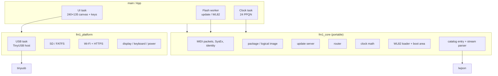
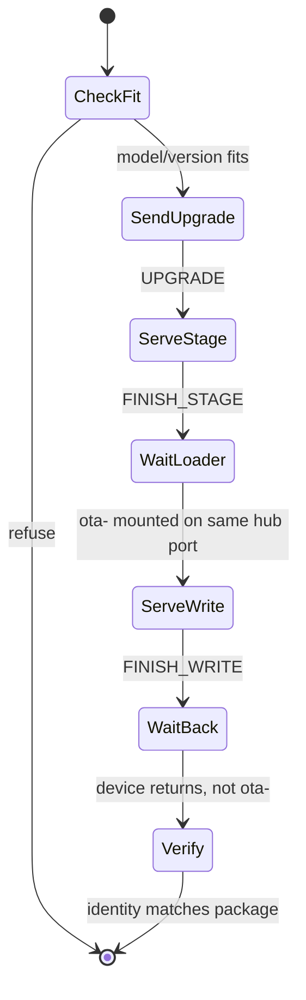

# Architecture

## Goals

- One handheld box replaces the desktop for the FM-1 workflow: discover,
  download, flash, route, clock.
- Keep the protocol and package logic portable and testable on a laptop.
- Make memory behaviour explicit: no PSRAM, no giant JSON DOM, no LVGL.
- Prefer boring, small mechanisms: one USB task, one UI task, one flash
  worker, queues between them.

## Layers



- **fm1_core** has no ESP-IDF or FreeRTOS includes. It is built by the native
  test CMake and by the firmware.
- **fm1_platform** owns every C API and every task/queue.
- **fm1_ui** depends only on a `Canvas` and a small `KeyEvent` type.

## Tasks and ownership

| Task | Priority | Owns |
|---|---:|---|
| `usb` | 5 | `tuh_task`, all host writes, RX callbacks |
| `ui` | 4 | canvas, keyboard polling, app state |
| `flash` | 3 | one flash operation at a time, claims one port |
| `clock` | 5 | tick deadline, posts packets to `usb` |
| `net` | 2 | Wi-Fi, catalog fetch, package download |

All USB API calls happen on the `usb` task. Other tasks post `TxPacket`
items to a queue; the USB task drains it after every `tuh_task` pass. This
avoids the host stack's lack of cross-task guarantees without adding a lock
around every transfer.

RX path: TinyUSB callback → per-device packet queue → MIDI parser / router.
The callback never blocks and never writes to the display.

## Memory budget (target)

| Item | ~bytes |
|---|---:|
| 4-bpp canvas 240×135 | 16 200 |
| two 240×16 RGB565 DMA bands | 15 360 |
| TinyUSB host + hub + MIDI ×8 + MSC | ~30 000 |
| MIDI RX/TX FIFOs (8 × 1 KB / 2 KB) | ~24 000 |
| lwjson stream parser | ~1 000 |
| catalog page (60 entries) | ~42 000 |
| Wi-Fi + lwIP + TLS (transient) | ~80 000 |
| app/queues/stacks | ~40 000 |

The catalog is ~375 KB (746 entries) and is never resident. Packages are streamed from SD;
the update server reads the requested range directly out of the `.fwsc`
container (no temporary 1 MB image).

## Catalog ingestion

1. `net` opens the catalog URL over HTTPS.
2. Bytes are fed to `lwjson`'s stream parser one at a time.
3. When the parser is inside `firmwares[]` at `OBJECT` depth, top-level
   fields are captured (strings may arrive in chunks; the parser decodes
   escapes and UTF-8).
4. A completed entry is appended to a temporary binary cache on SD.
5. On success the temp file is renamed to `catalog.bin`; on failure it is
   deleted and the previous cache stays.

No part of the raw JSON is retained. `catalog.bin` is a sequence of
length-prefixed records; the UI scans it for pages and filters.

## USB device identity

TinyUSB exposes `tuh_bus_info_t { rhport, hub_addr, hub_port }` for each
device address. The pair `hub_addr/hub_port` is stable while a device reboots
through its update loader (the hub does not re-enumerate), so it is the
flash-flow key. `dev_addr` is not stable.

A mounted MIDI interface is probed with the FM-1 handshake:

```
F0 00 32 45 00 00 00 40 7F F7
```

The response is a 7-bit-packed SysEx whose payload starts `00 59 11` and
carries `MODEL_VERSION` (`FM-1_916`, `ota-FM-1_904`, …). A port that answers
is a *known* unit; one that does not is still a valid MIDI port and a valid
rescue-flash target.

## Routing and clock

- The router is a set of `source device id → sink device ids`. Forwarding is
  raw 4-byte USB-MIDI event packets, preserving cable and CIN. This keeps
  SysEx and real-time interleaving intact.
- The clock task posts one `F8` packet per tick to each clock target. Start
  and stop send `FA`/`FC` and reset the tick phase. A target being flashed is
  removed from both routing and clock; its bytes would corrupt the update
  protocol.
- `Fn`+clock screen can send a single `F8` test, and shows the measured
  interval so USB scheduling jitter is visible.

## Flash flow

### Normal (running firmware)



The desktop waits 60–90 s for the loader and the return; the Cardputer uses
the same generous timeouts. `serve` answers 512-byte read requests from the
package's logical image at 10 ms pacing, exactly like the hub installers.

### Rescue

An unidentified MIDI port gets `UPGRADE` directly, then one `serve` with both
finish addresses. If the port was already in the update loader, the write
happens in that same pass.

### Download mode + rescue bootloader

`DOWNLOAD MODE` (`F0 22 24 35 7D F7`) makes a running FM-1 reboot into the
JieLi ROM's USB disk (`WL82 / UBOOT1.00`). That device is handled by TinyUSB
MSC with vendor SCSI CDBs:

1. Inquiry, upload `mflr-loader-a.bin` if the ROM loader is not answering.
2. Read the full 1 MiB flash; verify CRC32; save to SD.
3. Analyze the boot area, choose `fm1` or `smk37` from the bootloader
   identity/flash id, build a replacement 16 KiB boot area with the MIT
   m-bootloader, keeping the unit's chip-key record.
4. Erase 0x0000–0x4000, write, read back and compare.
5. Reboot; the unit should return with the open bootloader.

Never power off during 4. If verification fails, the previous backup is on
the card and the unit is recoverable through the ROM disk.

## Why TinyUSB, not ESP-IDF's usb_host

ESP-IDF's host stack is solid and supports hubs, but it has no MIDI class
driver and no raw-SCSI MSC API. TinyUSB has both (`tuh_midi_*`,
`tuh_msc_scsi_command`) and its ESP32-S3 DWC2 host port is maintained by the
TinyUSB project. The trade-off is that we vendor TinyUSB and own the
integration; `docs/` and the CMake component keep that boundary explicit.

## Why lwjson, not ArduinoJson/jsmn

- The catalog is ~375 KB (746 entries); a DOM is 150–250 KB on a 512 KB part.
- lwjson's stream parser is zero-allocation, decodes escapes/UTF-8, and has a
  fixed ~1 KB footprint.
- jsmn would still require a token pool and hand-decoding.
- ArduinoJson remains a fine choice for small documents; it is not needed
  here, and one parser is easier to audit.
